# 1. 在 Windows 下制作 Ubuntu 24.04 启动盘
## 1.1. 准备工作

1. 在官网上下载对应的 [Ubuntu 镜像文件](https://releases.ubuntu.com/noble/)
2. 找一个闲置且空白的 U 盘或者硬盘（ 8G 及以上）
3. 在官网下载 [rufus](https://rufus.ie/zh/)

## 1.2. 制作 Ubuntu 启动盘

打开 rufus，选择镜像文件和设备，之后点击写入即可完成安装盘制作

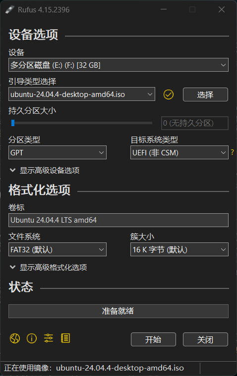

> 此处目标机硬盘选择为GPT，大家可以在 PowerShell 中输入 Get-Disk 来查看硬盘类型

# 2. 硬盘分区

在 Windows 系统，搜索栏输入“磁盘管理”并进入

找到空闲的磁盘，点击压缩卷 **(可以利用删除卷来获取更多空间！！！注意该磁盘内所有内容将清空)** 

删除后你将获得一些空闲空间来安装 Ubuntu 系统，这个时候那些空间会变为灰色

建议为 Ubuntu 配置 200GB 的分区，避免后续因 Ubuntu 空间不足而重装系统

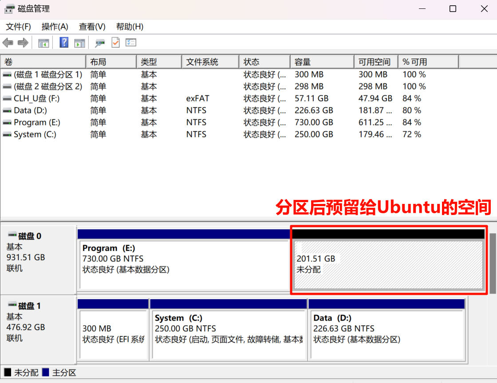

# 3. GPT分区形式安装方式

## 3.1. 进入BIOS

1. 关机后开机（重启）

2. 插入 Ubuntu 安装盘（之前制作好啦）

3. 进入 BIOS 

4. 寻找 `Secure Boot` 选项，设置为 **`Disabled`**

  > 如果后续需要安装 NVIDIA 驱动、CUDA，建议先关闭 Secure Boot，避免驱动模块因签名问题无法加载。

5. 在 BIOS 启动启动盘中的系统

## 3.2. 安装系统

启动安装盘后，安装程序会依次引导完成基础设置。

1. 选择安装界面语言。本文截图使用 English，选择其他语言不会影响后续安装步骤。

   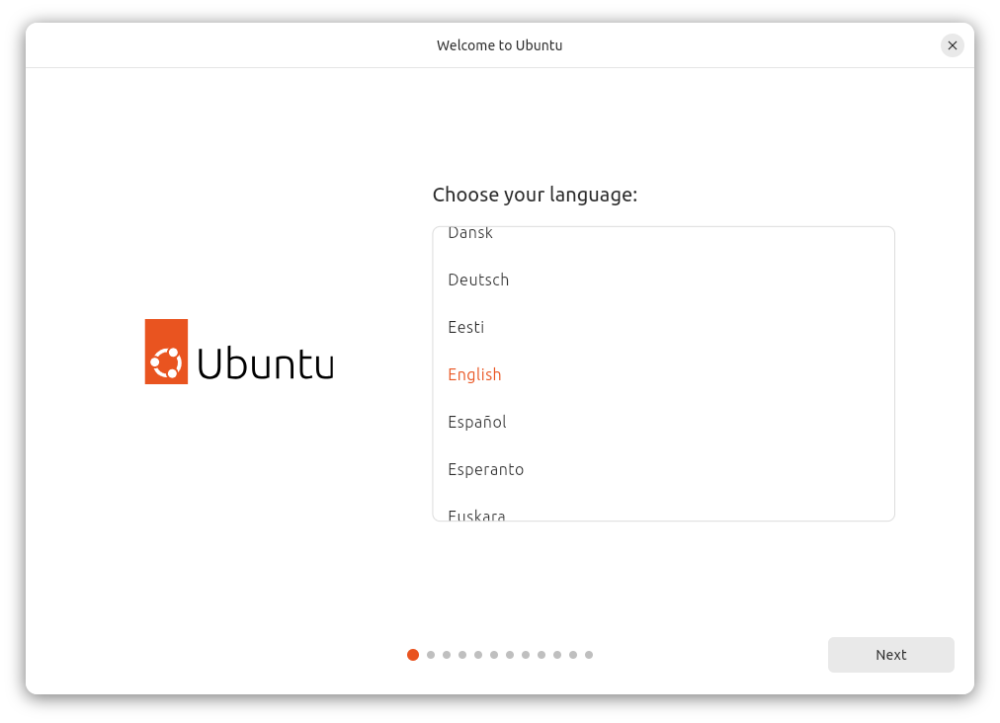

2. 按需配置视觉、听觉、输入和缩放等辅助功能；没有特殊需求可以直接点击 **Next**。

   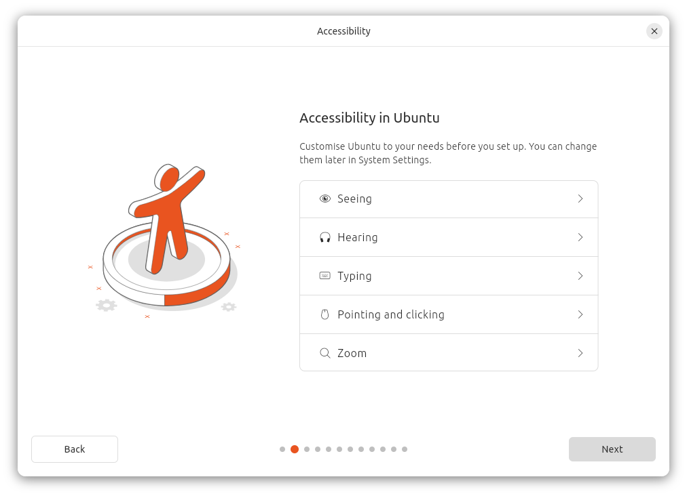

3. 选择键盘布局。常用美式键盘可选择 **English (US)**，并在输入框中测试按键。

   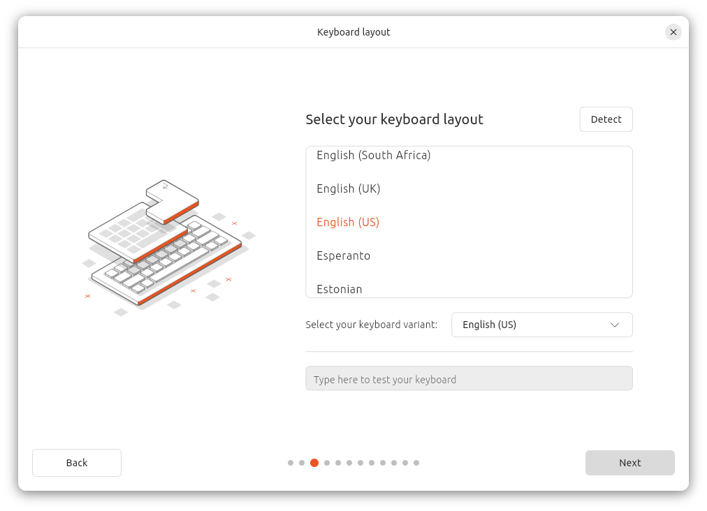

4. 选择网络连接。联网可以在安装过程中获取更新和硬件支持；暂时无法联网也可以选择离线安装。

   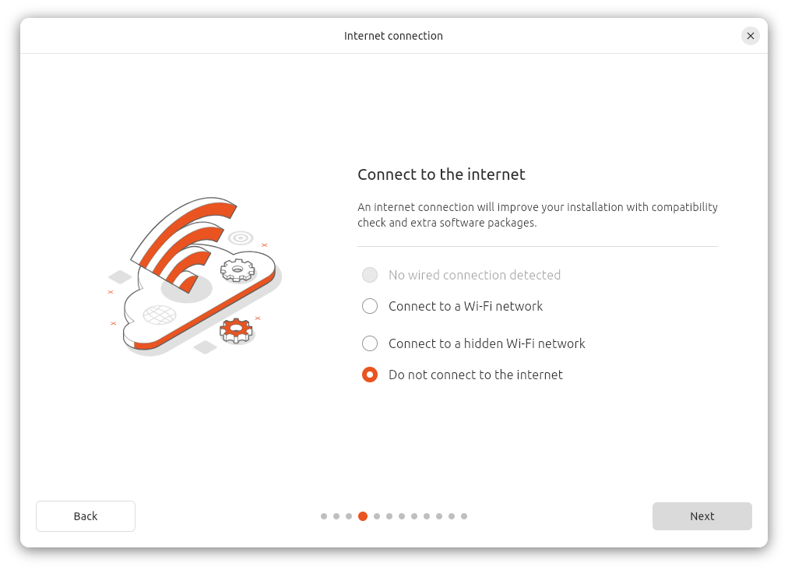

5. 选择 **Install Ubuntu**，然后选择 **Interactive installation**，使用图形界面逐步完成安装。

   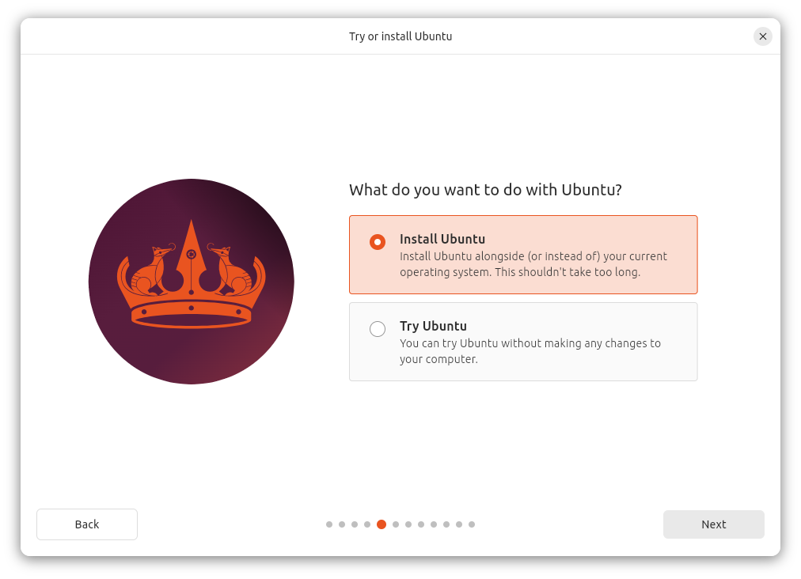

   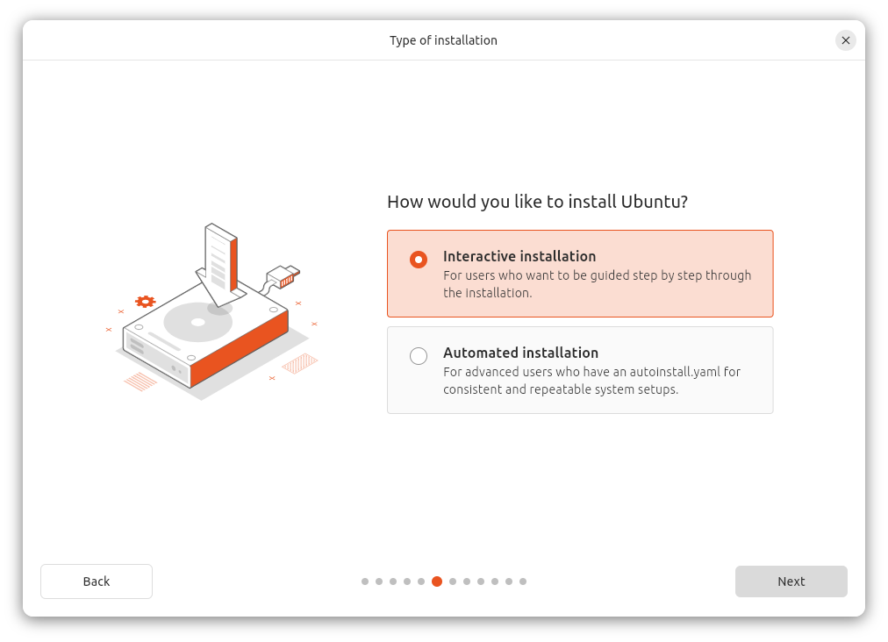

6. 选择预装应用。**Default selection** 只安装基础工具；需要办公软件和更多常用工具时可选择 **Extended selection**。

   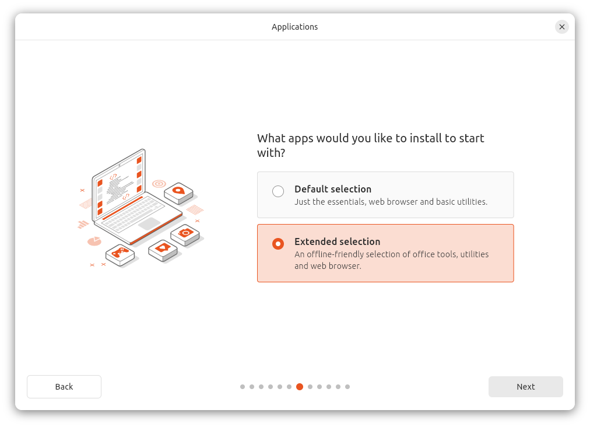

7. 如果电脑使用 NVIDIA 显卡或需要额外的 Wi-Fi 驱动，建议联网并勾选安装第三方专有软件。

   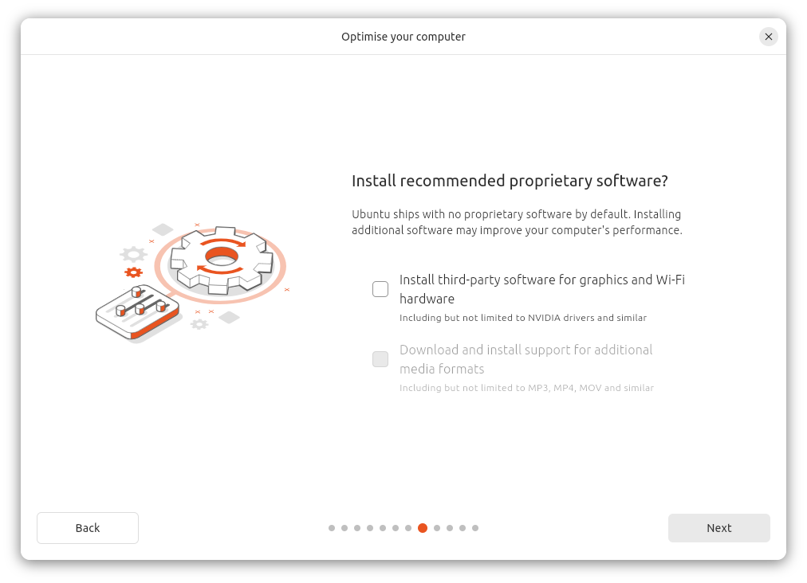

## 3.3. 手动分区

为了使用之前在 Windows 中预留的空闲空间，选择 **Manual installation**。

> 分区操作有丢失数据的风险。请根据磁盘容量和现有 Windows 分区确认目标磁盘，切勿格式化 Windows、BitLocker 或恢复分区。下面的分区编号和容量只是示例，以你的电脑实际情况为准。

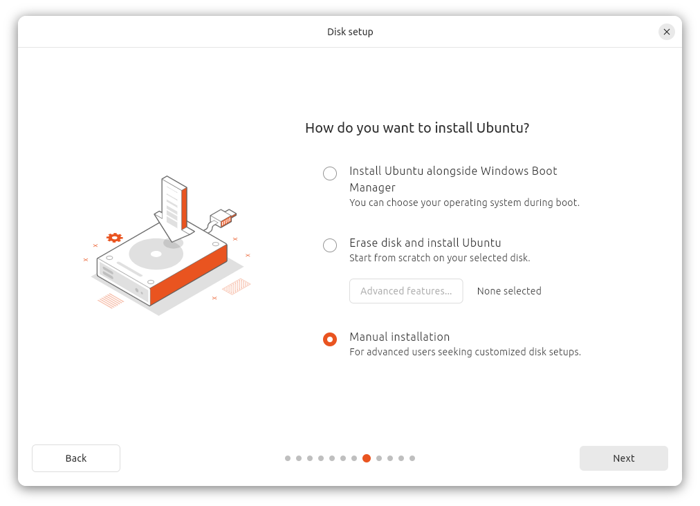

在分区列表中找到之前预留的 **Free space**。截图中的目标磁盘是 `nvme0n1`，可用空间约为 214.75 GB。

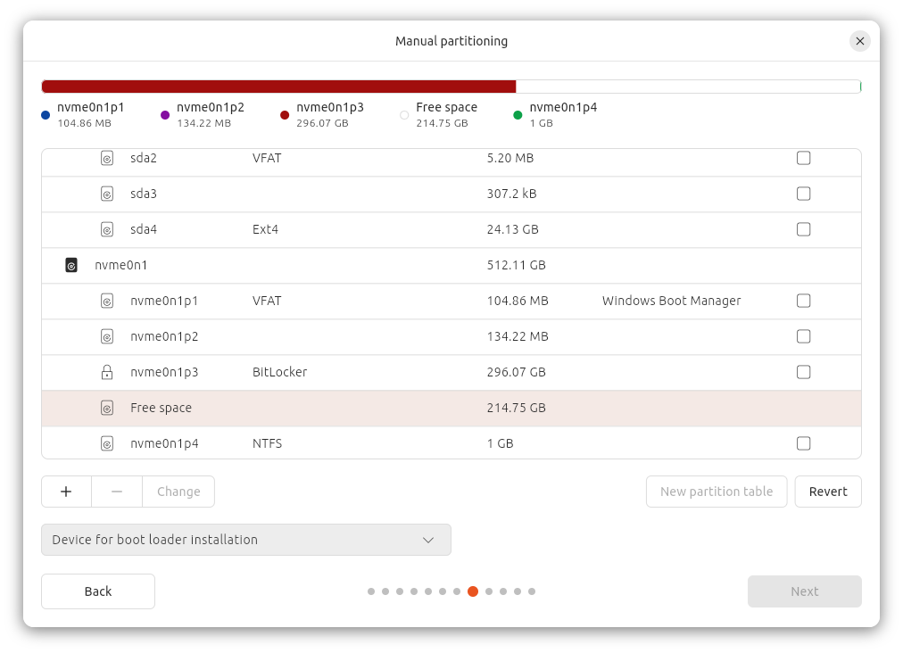

可以参考下面的方案创建分区：

| 挂载点 | 建议大小 | 文件系统 | 说明 |
| --- | ---: | --- | --- |
| `/boot/efi` | 复用现有 EFI 分区 | VFAT | GPT 双系统通常复用 Windows Boot Manager 所在的 EFI 分区，不要格式化 |
| `/boot` | 500 MB 左右 | Ext4 | 存放内核和启动文件 |
| `swap` | 视内存和休眠需求而定 | Swap | 示例分配 16 GB |
| `/` | 剩余空间 | Ext4 | Ubuntu 系统和用户文件 |

完成后逐项核对挂载点、容量、格式化选项和底部的引导加载器目标磁盘。

选择根分区 `/` 后再次确认它位于刚才创建的 Linux 分区中，然后点击 **Next**。

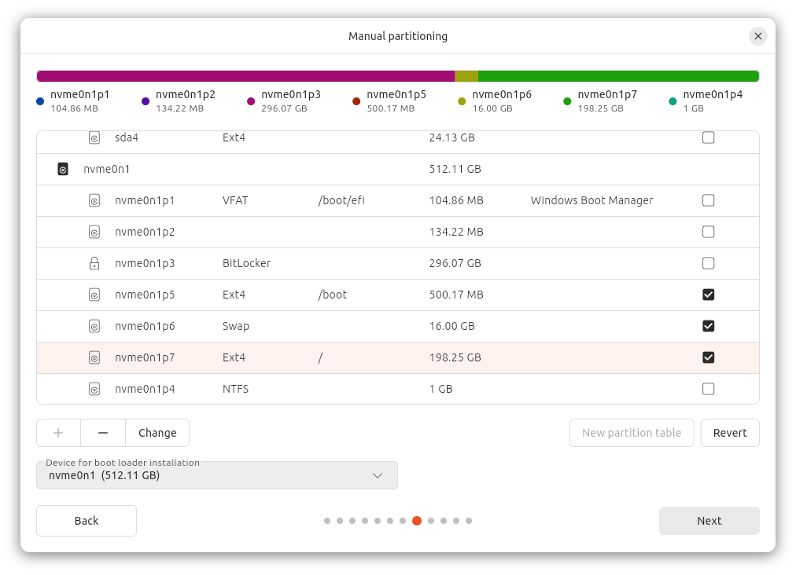

## 3.4. 创建账户并选择时区

填写姓名、计算机名、用户名和密码。截图中的内容仅为示例，请设置强密码并妥善保存。

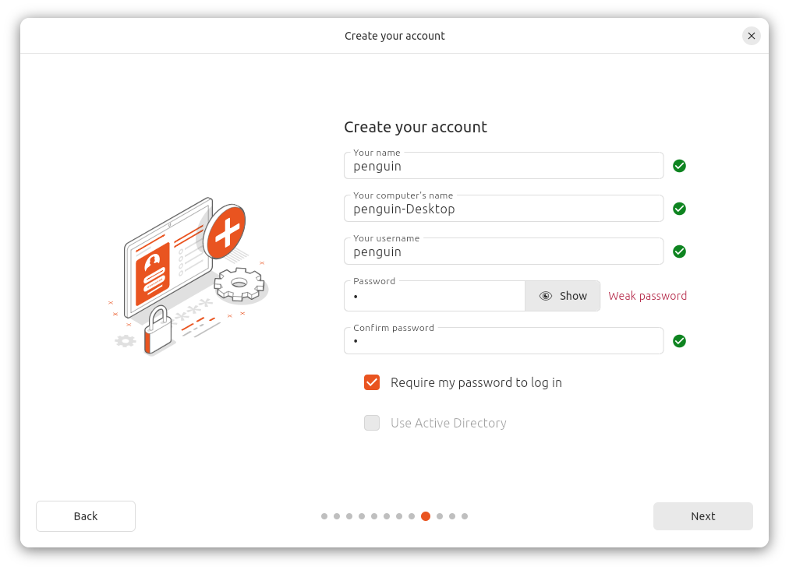

选择所在地和时区，中国大陆通常使用 **Asia/Shanghai**。

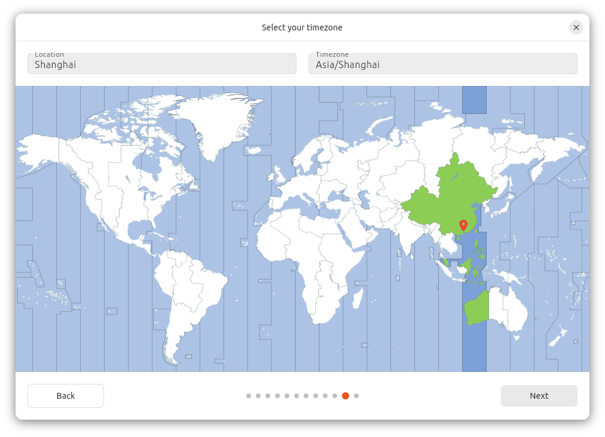

最后检查安装摘要，确认无误后开始安装。安装完成并提示重启时，拔出安装 U 盘，再按提示进入新系统。

